---

**Meduri Karthik Venkata Naga Sai Manikanta**

I build backend systems that scale, frontend experiences that feel right, and ML pipelines that learn. I'm currently deepening my foundations in distributed systems, system design, and cloud-native architecture while shipping real projects along the way.

My academic background in AI & ML gives me an edge when working at the intersection of data and software—I understand the engineering side as well as the intelligence layer.

---

## Selected Projects

| Project | Description | Stack |
|---------|-------------|-------|
| [**DSA-Practice**](https://github.com/24pa1a4573-ship-it/DSA-Practice) | Structured data structures and algorithms practice repository | Java |
| [**ReactBasics**](https://github.com/24pa1a4573-ship-it/ReactBasics) | React fundamentals and component architecture exploration | JavaScript |

> Browse all 33+ repositories at [github.com/24pa1a4573-ship-it](https://github.com/24pa1a4573-ship-it?tab=repositories)

---

## Achievements

<table>
<tr>
<td width="50%">

**Code Slayer Hackathon**
One of the top teams selected to represent at the inter-college level.

</td>
</tr>
</table>

**Education:** B.Tech in Artificial Intelligence and Data Science — Vishnu Institute of Technology | CGPA: 9.44

---

## Skills

**Languages**
`Java` `Python` `JavaScript`

**Frontend**
`React` `Angular`

**Backend & Databases**
`Spring Boot` `REST APIs` `MySQL` `Firebase`

**ML & Data**
`scikit-learn` `NumPy` `Pandas` `Matplotlib`

**Cloud & DevOps**
`Google Cloud` `Docker` `Kubernetes` `Vercel` `Git` `GitHub` `GitLab`

---

## Contribution Graph

> If the graph above is unavailable, view live contributions directly on [my GitHub profile](https://github.com/24pa1a4573-ship-it).

---

## GitHub Statistics

---

## Connect

&nbsp;
&nbsp;

---

